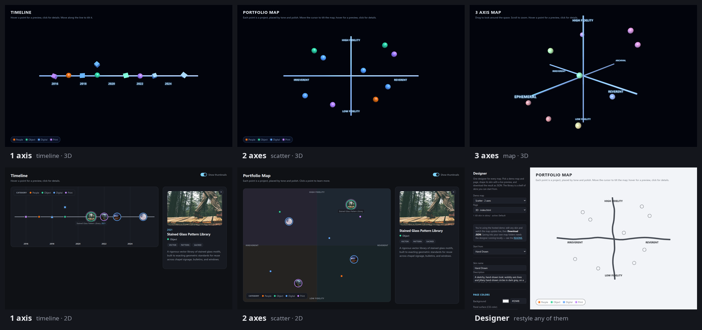
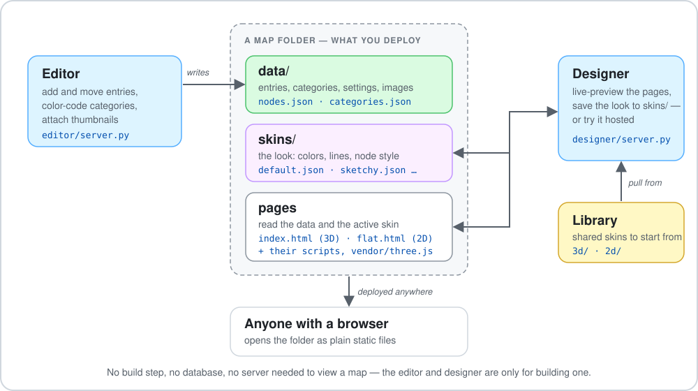
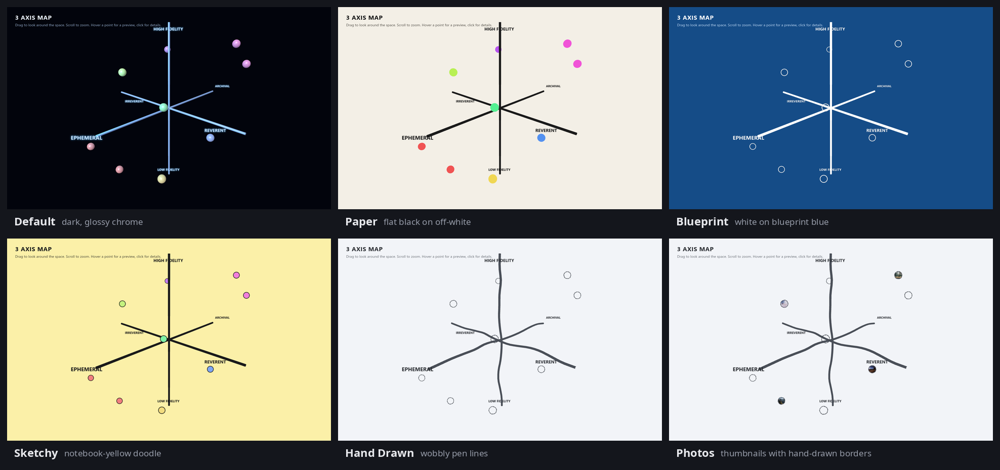
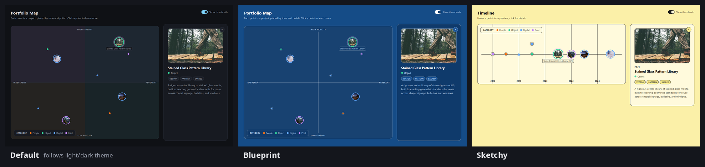
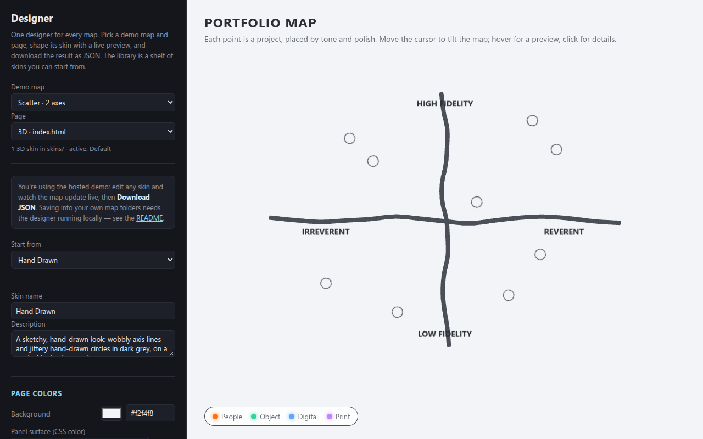
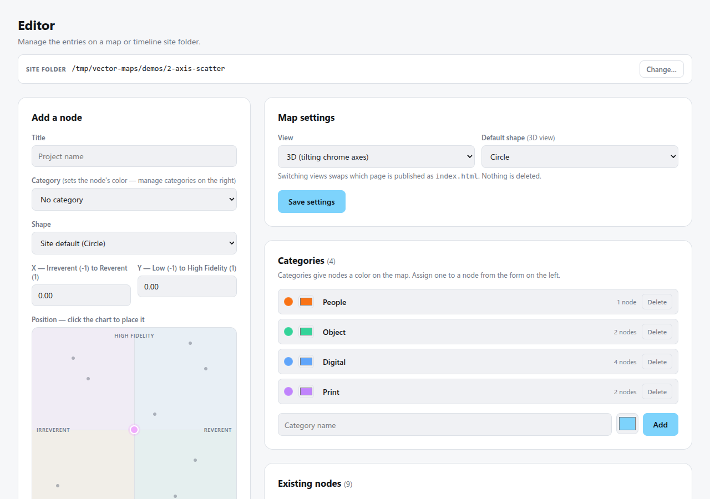

# Vector Maps

Interactive maps of a body of work. Place projects on **one axis** (a timeline), **two axes** (a scatter chart), or **three axes** (a cube you can orbit) — each in plain 2D or in 3D — then change how any of them looks with swappable **skins**.

Every map is just a folder of static files: no build step, no database, nothing to run to *view* one. Two small local tools help you *make* them: an **Editor** for the content and a **Designer** for the look.

<p align="center">
  
</p>

## Try it now

All of these run in your browser — nothing to install.

| | 3D | 2D |
|---|---|---|
| **1 axis** — a timeline | [Open](https://aheathne.github.io/vector-maps/demos/1-axis-timeline/) | [Open](https://aheathne.github.io/vector-maps/demos/1-axis-timeline/flat.html) |
| **2 axes** — a scatter chart | [Open](https://aheathne.github.io/vector-maps/demos/2-axis-scatter/) | [Open](https://aheathne.github.io/vector-maps/demos/2-axis-scatter/flat.html) |
| **3 axes** — a cube you orbit | [Open](https://aheathne.github.io/vector-maps/demos/3-axis-map/) · [at an angle](https://aheathne.github.io/vector-maps/demos/3-axis-map/?theta=0.75&phi=1.2) | — |

**Restyle them live in the [hosted Designer](https://aheathne.github.io/vector-maps/designer/)** — pick a demo, pull in a skin, tweak every color, and download the result. Or jump straight to a look:

- [3-axis map, Blueprint](https://aheathne.github.io/vector-maps/designer/?map=3-axis-map&page=index.html&skin=lib:blueprint) · [Hand Drawn](https://aheathne.github.io/vector-maps/designer/?map=3-axis-map&page=index.html&skin=lib:hand-drawn) · [Sketchy](https://aheathne.github.io/vector-maps/designer/?map=3-axis-map&page=index.html&skin=lib:sketchy)
- [Timeline, Paper](https://aheathne.github.io/vector-maps/designer/?map=1-axis-timeline&page=index.html&skin=lib:paper) · [scatter, Blueprint](https://aheathne.github.io/vector-maps/designer/?map=2-axis-scatter&page=index.html&skin=lib:blueprint)
- [Flat timeline, Sketchy](https://aheathne.github.io/vector-maps/designer/?map=1-axis-timeline&page=flat.html&skin=lib:sketchy-2d) · [flat scatter, Blueprint](https://aheathne.github.io/vector-maps/designer/?map=2-axis-scatter&page=flat.html&skin=lib:blueprint-2d)

> **About the Editor.** The Editor changes files on your disk, which a web page can't do, so it can't be hosted here — it's a small Python tool you run locally ([screenshot below](#the-editor), [how to run it](#run-it-locally)). The hosted Designer is the same, with one difference: it can't save into a folder, so you **download** the skin instead.

## What's in this repo

| Folder | What it is |
|---|---|
| [`demos/`](demos) | Five working maps in three folders — [timeline](demos/1-axis-timeline), [scatter](demos/2-axis-scatter), [3-axis map](demos/3-axis-map). Each is a complete, independent site you could deploy as-is. |
| [`designer/`](designer) | The **Designer**: build and preview a skin for any map. Runs locally (saves into your map folders) or hosted (download only). |
| [`editor/`](editor) | The **Editor**: add and arrange a map's entries, categories and thumbnails. Also scaffolds new maps. |
| [`docs/`](docs) | Images used in this README. |

## How it works

<p align="center">
  
</p>

### 1. A map is a folder

Everything a map needs lives in one folder, and a visitor needs nothing else:

```
my-map/
  index.html  flat.html     the pages: 3D (Three.js) and 2D (plain HTML/CSS)
  script.js   flat.js …     their code, plus vendor/three.module.min.js
  data/
    nodes.json              the entries
    categories.json         named, colored groups of entries
    config.json             title, subtitle, default shape, which skin is active
  skins/
    default.json …          the look (see below)
  images/                   optional thumbnails
```

Deploy the folder to GitHub Pages, Netlify, S3, or any static file host — that's all.

**Entries** are plain JSON. What differs between the maps is how an entry is *placed*:

| Map | Placement | Example entry |
|---|---|---|
| 1 axis — timeline | a `date` (`"2019"`, `"2019-06"` or `"2019-06-14"`) | `{"title": "Hymnal Redesign", "date": "2016", "category": "print"}` |
| 2 axes — scatter | `x` and `y`, each from −1 to 1 | `{"title": "Sunday School Zine", "x": 0.4, "y": -0.65, "category": "people"}` |
| 3 axes — map | `x`, `y` and `z`, each from −1 to 1 | `{"title": "Hymnal Redesign", "x": 0.7, "y": 0.6, "z": 0.75, "category": "print"}` |

Every entry can also have a `description`, `tags`, a `link`, an `image` and a `shape` (`circle`, `cube` or `pyramid`). A node's color comes from its category (or from where it sits, depending on the skin) — never hand-picked per node.

**What you can do on a map:** hover a point for a preview, click it for details. The 3D timeline and scatter tilt toward your cursor; the 3-axis map is dragged to orbit and scrolled to zoom (open it [at an angle](https://aheathne.github.io/vector-maps/demos/3-axis-map/?theta=0.75&phi=1.2) to see why it needs it); the 2D pages have a "Show thumbnails" switch.

### 2. Content and look are separate

The **Editor** owns the content (`data/`, `images/`). The **Designer** owns the look (`skins/`, plus which skin is active in `data/config.json`). Neither one is needed to *show* a map, and a map never links back to either.

### 3. Skins

A skin is one small JSON file: colors, line style, how nodes are drawn, whether the map tilts. Swap the active skin and the same data looks completely different:

<p align="center">
  
</p>

```json
{
  "name": "Hand Drawn",
  "kind": "3d",
  "css":   { "bg": "#f2f4f8", "text": "#2b2e34", "accent": "#2b2e34" },
  "lines": { "style": "sketch", "color": "#4a4f58", "thickness": 4 },
  "nodes": { "style": "flat", "fill": "sketch", "outlineColor": "#4a4f58", "pixelRadius": 11 },
  "motion": { "tilt": true }
}
```

A skin only lists what it changes. Highlights of what's possible: glossy, flat, wireframe or **hand-drawn** lines and nodes; filled, outlined or sketched circles; thumbnails inside the circles (with an optional viewer-facing *Show/Hide Photos* switch); node colors from a category, from where the node sits in space, or from a fixed palette; and turning the cursor-tilt off for a static map.

Skins come in two **kinds**, because the two kinds of page are built differently:

- **3D skins** work on all three 3D maps (timeline, scatter, 3-axis). A map just ignores anything it can't draw — a skin colored "by region" falls back to "by category" on the timeline, which has no regions.
- **2D skins** work on both flat pages, and are deliberately simpler:

<p align="center">
  
</p>

The flat pages also follow the viewer's light/dark system theme unless a skin sets its own colors. The full skin fields are documented in each demo's README — [3D](demos/3-axis-map#skins), [2D](demos/2-axis-scatter#the-flat-views-skins).

### 4. The Designer

<p align="center">
  
</p>

Open a map, choose a page (3D or 2D), start from a skin, and every control updates the live preview. Every color has both a swatch picker and a hex field. It saves into the map's own `skins/` and can set it active — or, hosted, downloads the JSON.

It doesn't know anything about any particular map. A page opts in by exposing a small hook that says what kind of skin it takes and what it can draw, and the Designer builds its form from that — so adding a new kind of map means implementing the hook, not changing the Designer. The **library** (`designer/library/`) is a shelf of ready-made skins to start from; maps never read from it, they ship their own copy of whatever they use. Details: [`designer/README.md`](designer/README.md).

### 5. The Editor

<p align="center">
  
</p>

Point it at a map folder and add, move and delete entries, define categories and their colors, and set the map's title and view. Point it at an empty folder to start a new map: it fills in the pages, skin support and starter data, so the new map opens in the Designer straight away. Details: [`editor/README.md`](editor/README.md).

## Run it locally

You need **Python 3** (nothing else — everything is the standard library).

```bash
git clone https://github.com/AHeathNE/vector-maps.git
cd vector-maps
```

```bash
python3 designer/server.py     # → http://localhost:8430
```

```bash
python3 editor/server.py       # → http://localhost:8420
```

Each opens in your browser. The Designer starts on the 3-axis demo; type a folder path (or just `timeline`, `scatter`) to open another map, and **Save to this map** writes straight into it. The Editor starts on the scatter demo.

To just view a demo locally, run its own tiny server (any static file server works):

```bash
python3 demos/3-axis-map/serve.py     # → http://localhost:8082
```

(`demos/1-axis-timeline` serves on 8081 and `demos/2-axis-scatter` on 8080.)

Both tools only listen on `localhost` and refuse writes that don't come from their own page — they edit files on your disk, so they're not meant to be exposed to a network.

## Make your own map

1. **Create it.** Run the Editor, enter the path of a new empty folder, and choose *scatter map* or *timeline*.
2. **Fill it.** Add entries and categories in the Editor (or edit `data/nodes.json` by hand).
3. **Style it.** Run the Designer, open the same folder, start from a library skin, adjust, and **Save to this map**.
4. **Publish it.** Upload the folder to any static host. (GitHub Pages: push the folder, then *Settings → Pages*.)

The 3-axis map isn't scaffolded by the Editor; copy [`demos/3-axis-map`](demos/3-axis-map) and edit its `data/` (its axis labels are in `data/config.json`).

## Credits and license

- Code: [MIT](LICENSE).
- 3D rendering: [Three.js](https://threejs.org/) (MIT), vendored in each map's `vendor/` folder so maps work offline.
- The sample thumbnails are placeholder photos from [Lorem Picsum](https://picsum.photos/) (photographs by [Unsplash](https://unsplash.com/) contributors) and have nothing to do with the sample project titles. Swap in your own.
